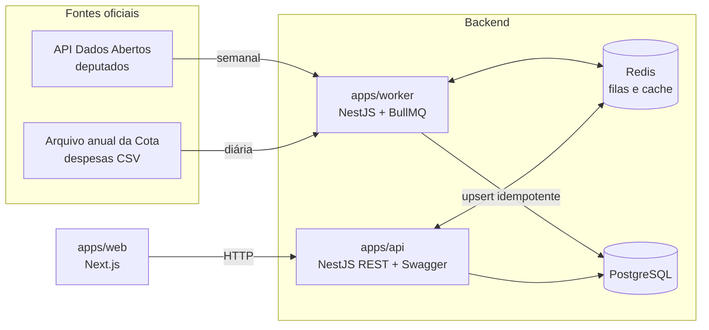

# Raio-X Público

Plataforma web para explorar os gastos públicos de parlamentares brasileiros a partir de **dados abertos oficiais**. Pesquise um deputado federal, veja como ele usa a Cota para o Exercício da Atividade Parlamentar (CEAP), compare com outros parlamentares e descubra quais fornecedores receberam dinheiro público.

> Apresentação neutra: o projeto mostra números e a fonte oficial, sem conclusões editoriais.

**Status:** Fases 1 e 2 concluídas (MVP da Câmara, rankings, fornecedores, comparação e cache) · próxima: Fase 3 (Senado e emendas parlamentares).

## Arquitetura



O front-end **nunca** chama as APIs do governo diretamente: tudo passa por ingestão → Postgres → API própria. Assim os dados ficam normalizados, as consultas agregadas são rápidas e a disponibilidade não depende das fontes externas.

## Estrutura do monorepo

| Caminho                  | Descrição                                                       |
| ------------------------ | --------------------------------------------------------------- |
| `apps/web`               | Next.js (App Router), Tailwind, shadcn/ui, TanStack Query       |
| `apps/api`               | API REST em NestJS, validação com Zod, documentação em `/docs`  |
| `apps/worker`            | Ingestão de dados com BullMQ (jobs agendados e idempotentes)    |
| `packages/db`            | Schema Prisma, migrations e client compartilhado (API e worker) |
| `packages/shared`        | Schemas Zod, tipos e utilitários usados no front e no back      |
| `packages/tsconfig`      | Configurações TypeScript (strict) compartilhadas                |
| `packages/eslint-config` | Configurações ESLint compartilhadas (type-aware, sem `any`)     |

## Funcionalidades

| Página                      | O que mostra                                                                                         |
| --------------------------- | ---------------------------------------------------------------------------------------------------- |
| `/`                         | Totais do ano, gastos por categoria, maiores totais e gastos por estado (total e média por deputado) |
| `/parlamentares`            | Busca por nome (tolera erros de digitação), partido e UF                                             |
| `/parlamentares/[id]`       | Evolução mensal, categorias, maiores fornecedores e despesas com link para a nota fiscal             |
| `/ranking`                  | Total por deputado no ano, com filtros de categoria, partido e UF                                    |
| `/fornecedores/[documento]` | Quanto o fornecedor recebeu e de quais deputados                                                     |
| `/comparar`                 | 2 a 4 deputados lado a lado: totais, evolução mensal e categorias                                    |

Todas as páginas mostram a fonte oficial e a data da última sincronização, funcionam em
tema claro e escuro, no celular, e são verificadas com axe-core nos testes e2e.

### API

| Endpoint                                | Descrição                                           |
| --------------------------------------- | --------------------------------------------------- |
| `GET /parlamentares`                    | Lista com busca e filtros, paginada                 |
| `GET /parlamentares/:id`                | Dados e resumo de gastos                            |
| `GET /parlamentares/:id/despesas`       | Despesas com filtros de ano, mês e categoria        |
| `GET /parlamentares/:id/gastos-mensais` | Série mensal                                        |
| `GET /rankings`                         | Total por parlamentar (ano, categoria, partido, UF) |
| `GET /estatisticas`                     | Totais gerais, por categoria e por estado           |
| `GET /fornecedores/:documento`          | Fornecedor e parlamentares que o pagaram            |
| `GET /comparacao?ids=a,b`               | Comparação de 2 a 4 parlamentares                   |
| `GET /meta/sync`                        | Última sincronização de cada fonte                  |

Documentação interativa em `/docs` (Swagger). Os endpoints agregados usam cache em Redis.

## Como rodar localmente

Pré-requisitos: Node.js 24 (ver `.nvmrc`), pnpm 11 e Docker.

```bash
# 1. Variáveis de ambiente
cp .env.example .env

# 2. Postgres e Redis
docker compose up -d

# 3. Dependências e banco
pnpm install
pnpm db:deploy        # aplica as migrations

# 4. Carga inicial: deputados + despesas dos anos em SYNC_INITIAL_YEARS (~7 min)
pnpm sync:initial

# 5. Subir web (3000), API (3001) e worker em modo dev
pnpm dev
```

- Front-end: http://localhost:3000
- API: http://localhost:3001 · health check em `/health` · Swagger em `/docs`

## Scripts

| Comando             | O que faz                                                                          |
| ------------------- | ---------------------------------------------------------------------------------- |
| `pnpm dev`          | Sobe todos os apps em modo desenvolvimento                                         |
| `pnpm build`        | Build de todos os pacotes e apps                                                   |
| `pnpm lint`         | ESLint em todo o monorepo                                                          |
| `pnpm typecheck`    | Checagem de tipos                                                                  |
| `pnpm test`         | Testes unitários (Vitest)                                                          |
| `pnpm test:e2e`     | e2e da API (Supertest), integração do worker (Postgres) e front (Playwright + axe) |
| `pnpm sync:initial` | Carga inicial de deputados e despesas                                              |
| `pnpm db:migrate`   | Cria/aplica migrations em desenvolvimento                                          |
| `pnpm format`       | Formata o código com Prettier                                                      |

## Decisões técnicas

As decisões não óbvias estão registradas, com o motivo de cada uma, em [docs/decisoes.md](docs/decisoes.md). Destaques:

- **Despesas vêm do arquivo anual oficial da Cota (CSV), não da API**: a API devolve `valorLiquido` com o sinal invertido e exigiria ~2.100 requisições por ano.
- **Chave das despesas derivada do conteúdo**: a fonte não tem ID único por linha; reprocessar não duplica nada e o banco espelha a fonte.

- **Monorepo com Turborepo + pnpm**: tipos e schemas compartilhados entre front e back sem publicar pacotes; o Turbo cuida da ordem de build e do cache.
- **Worker separado da API**: a ingestão tem perfil de carga diferente (jobs longos, rate limit) e escala/faz deploy de forma independente.
- **Prisma 7 com driver adapter (`@prisma/adapter-pg`)** em um pacote próprio (`packages/db`), para que API e worker usem o mesmo schema e client.
- **Zod como fonte única de validação**: os mesmos schemas validam a entrada na API (via um `ZodValidationPipe` próprio) e tipam o front-end. O pacote `nestjs-zod` ainda não suporta NestJS 12, e o pipe próprio tem poucas linhas.
- **Valores monetários em `Decimal(12,2)`**, nunca `float`.
- **Busca de nomes com `pg_trgm`** (índice GIN sobre uma coluna normalizada sem acentos), tolerante a erros de digitação.
- **Chaves naturais em todos os upserts** (`idExterno`, documento do fornecedor, slug da categoria): rodar a ingestão duas vezes não duplica dados.
- **Vitest em todo o monorepo** (com SWC no NestJS para preservar os metadados de decorators); acessibilidade verificada com axe-core nos testes e2e do front.
- **Versões fixadas por compatibilidade**: TypeScript 6.0 (o typescript-eslint ainda não suporta o TS 7) e Prisma 7.10 (a tag `latest` aponta para um RC da v8).

## Fontes de dados

| Fonte                                                                                                                                                      | Uso                       | Fase |
| ---------------------------------------------------------------------------------------------------------------------------------------------------------- | ------------------------- | ---- |
| [Dados Abertos da Câmara](https://dadosabertos.camara.leg.br/swagger/api.html)                                                                             | Deputados                 | 1    |
| [Cota Parlamentar — arquivos anuais](https://www2.camara.leg.br/transparencia/cota-para-exercicio-da-atividade-parlamentar/dados-abertos-cota-parlamentar) | Despesas (CEAP)           | 1    |
| Dados Abertos do Senado (CSV da CEAPS)                                                                                                                     | Senadores e despesas      | 3    |
| [Portal da Transparência (CGU)](https://api.portaldatransparencia.gov.br)                                                                                  | Emendas parlamentares     | 3    |
| Dados Abertos do TSE                                                                                                                                       | Bens e contas de campanha | 4+   |

## Roadmap

- [x] **Fase 0**: monorepo, Docker Compose, Prisma, lint/format, CI
- [x] **Fase 1**: ingestão da Câmara, API de parlamentares/despesas, busca e página do parlamentar
- [x] **Fase 2**: rankings, fornecedores, comparação, estatísticas, cache
- [ ] **Fase 3**: Senado e emendas parlamentares
- [ ] **Fase 4**: pontos de atenção (detecção simples de valores fora do padrão)
- [ ] **Fase 5**: deploy e README final
